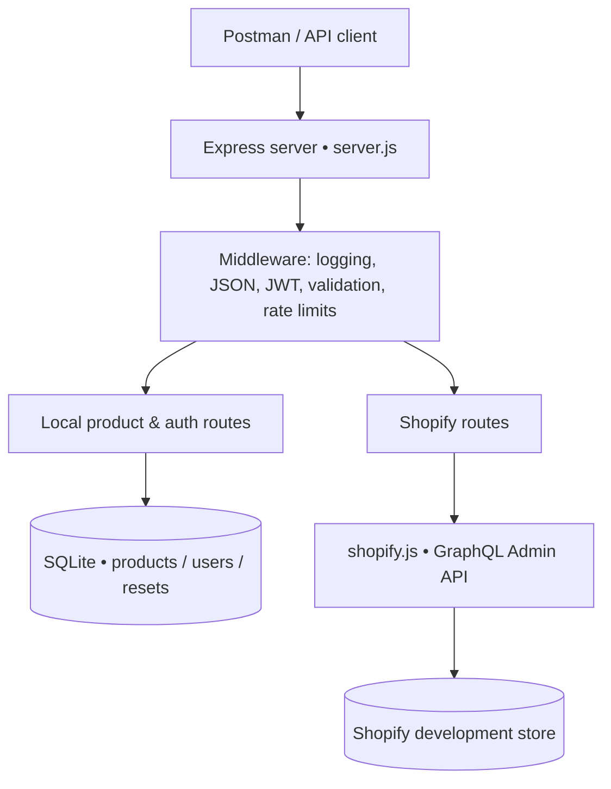

<div align="center">

# 🛍️ Node.js × Shopify Product Management API

### From local CRUD to real Shopify integration — one secure Express backend.

**Built by Iqra Nawaz**


**REST APIs** · **JWT authentication** · **Product CRUD** · **SQLite** · **Shopify GraphQL** · **Security middleware**

[Overview](#-overview) • [Features](#-features) • [Architecture](#-architecture) • [Quick Start](#-quick-start) • [API Reference](#-api-reference) • [Postman](#-postman-testing) • [Security](#-security--reliability)

</div>

---

## ✨ Overview

A backend-focused product management project that brings together **two independent product workflows**:

- **Local product management:** create, retrieve, update, and delete products stored in SQLite.
- **Shopify product management:** use protected Express routes to perform product operations against an authorized Shopify development store through the **GraphQL Admin API**.

The project also includes user registration, login, expiring JWTs, password hashing, controlled password recovery, request logging, input validation, and auth rate limiting.

> 💡 **Built to learn by doing:** from REST endpoints and database queries to external API authentication and real-world error handling.

> **Scope:** This is a **single-store backend API integration**, not an embedded Shopify admin app, merchant-facing dashboard, or multi-store OAuth installation flow. Local SQLite and Shopify products are **not automatically synchronized**.

## 🚀 Features

| Area | What's implemented |
|---|---|
| 🧩 Local Product CRUD | Create, list, retrieve, update, and delete products |
| 🛒 Shopify Integration | Read up to 20 products; create draft products; update title/description; delete products |
| 🔐 User Authentication | Signup, login, bcrypt password hashing, HS256 JWTs |
| 🔑 Password Recovery | Expiring, single-use reset tokens; token hashing; invalidation of older JWTs |
| 🧱 Validation | Data type, length, price, stock, and ID checks |
| 🛡️ API Security | Protected write operations, authentication rate limits, safe error responses |
| 📝 Logging | HTTP method and URL logging with query values redacted |
| 🧪 API Testing | Importable Postman collection with validation and lifecycle checks |
| 💾 Persistence | SQLite tables and additive database migrations |

## 🏗️ Architecture



**How it works:** a client sends a request → Express applies the appropriate middleware and validation → the route accesses **SQLite** or **Shopify** → a JSON response and HTTP status code are returned.

### 🗂️ Project structure

```text
.
├── server.js                    # Express app, API routes, auth and reset flows
├── database.js                  # SQLite schema and migrations
├── shopify.js                   # Shopify token exchange and GraphQL client
├── request-security.js          # URL-safe logging and authentication rate limits
├── test-shopify.js              # Live Shopify authentication/read check
├── postman/
│   ├── My Collection.postman_collection.json
│   └── Local Review.postman_environment.json
├── .env.example                 # Safe configuration template
├── .gitignore
├── package.json
├── package-lock.json
└── README.md
```

> `products.db`, `.env`, and `node_modules/` are created or configured locally and should **never** be committed with private data.

## 🖼️ Project snapshots

Add your own screenshots here after checking that they contain **no JWTs, passwords, API keys, tokens, or personal account details**.

| API in action | Shopify products |
|---|---|
| *Postman: successful local Product CRUD response* | *Shopify Admin: development store's Products page* |

<!-- Optional: once you add sanitized screenshots into docs/screenshots/, replace the captions above with:


Do not use these image paths until the files exist.
-->

## ⚡ Quick Start

### Requirements

- **Windows x64** — verified with **Node.js 24.21.0** and **npm 11.19.0**.
- An authorized **Shopify development store** and app credentials (currently required by startup configuration, even for local-only requests).
- Product scopes: `read_products` and `write_products` for live Shopify operations.

### 1. Install dependencies

```powershell
node --version
npm --version
npm ci --ignore-scripts
```

**Why `--ignore-scripts`?** On the verified Windows x64 configuration, the locked `better-sqlite3@13.0.3` package can trigger an unnecessary `node-gyp` rebuild during plain `npm ci`, which may require a Windows SDK. The locked `better-sqlite3` and `bcrypt@6.0.0` packages ship compatible Windows x64 prebuilt binaries; the installation and native functionality were verified in a fresh directory. **This is a version/platform-specific workaround, not a universal installation recommendation.** Keep the lockfile unchanged and perform the smoke test below.

```powershell
node -e "const Database=require('better-sqlite3'); const db=new Database(':memory:'); if(db.prepare('SELECT 1 AS ok').get().ok!==1) process.exit(1); db.close(); const bcrypt=require('bcrypt'); const hash=bcrypt.hashSync('temporary-native-check',12); if(!bcrypt.compareSync('temporary-native-check',hash)||bcrypt.compareSync('wrong-password',hash)) process.exit(1); console.log('SQLite and bcrypt native checks passed');"
```

If native packages fail to load, **do not assume installation succeeded**. A source build requires compatible Python and Visual Studio Build Tools with C++ and Windows SDK components; that path was not verified for this project. See [better-sqlite3 issue #1516](https://github.com/WiseLibs/better-sqlite3/issues/1516).

### 2. Configure environment

```powershell
Copy-Item .env.example .env
notepad .env
```

Fill in a **new random JWT secret (at least 32 characters)** and your own Shopify credentials. The configuration includes:

```dotenv
NODE_ENV=development
JWT_SECRET=replace_with_a_long_random_secret
SHOPIFY_SHOP=your-shop-slug
SHOPIFY_CLIENT_ID=your-client-id
SHOPIFY_CLIENT_SECRET=your-client-secret
```

Use only the store **slug** for `SHOPIFY_SHOP`, not the full `.myshopify.com` host. Refer to `.env.example` for all supported variables. **Never publish `.env`.** Do not overwrite an existing `.env` when updating the project.

Shopify's client-credentials grant applies to appropriately authorized same-organization stores: [Shopify setup documentation](https://shopify.dev/docs/apps/build/authentication-authorization/client-credentials-grant?lang=node).

### 3. Start the API

```powershell
node server.js
```

By default the API runs at **`http://127.0.0.1:3000`** (`PORT` can override it). Test with `GET /` in a browser or Postman. Startup creates `products.db` and applies additive migrations; **back up any existing database before deployment**.

## 📚 API Reference

### Local products

| Method | Route | Auth | Purpose |
|---|---|---|---|
| `GET` | `/` | Public | Health / server status |
| `POST` | `/products` | JWT | Create product — `201` |
| `GET` | `/products` | Public | List products — `200` |
| `GET` | `/products/:id` | Public | Retrieve product — `200` or `404` |
| `PUT` | `/products/:id` | JWT | Replace product fields — `200` |
| `DELETE` | `/products/:id` | JWT | Delete product — `200` |

Example request body:

```json
{
  "name": "Wireless Mouse",
  "description": "Bluetooth mouse",
  "price": 1499.5,
  "stock": 10
}
```

**Validation:** name required; price must be non-negative; stock must be a non-negative safe integer; product IDs must be positive safe integers. Invalid input returns `400`.

### Authentication & recovery

| Method | Route | Purpose |
|---|---|---|
| `POST` | `/auth/signup` | Register a user — `201` |
| `POST` | `/auth/login` | Authenticate and obtain JWT — `200` |
| `POST` | `/auth/forgot-password` | Request a reset token |
| `POST` | `/auth/reset-password` | Use a fresh, single-use token |

Signup body:

```json
{
  "name": "Demo User",
  "email": "demo@example.com",
  "password": "UseYourOwnStrongPassword"
}
```

For protected routes, provide the token returned by login:

```http
Authorization: Bearer <jwt_token>
```

Passwords must contain at least 8 characters and no more than 72 UTF-8 bytes. Reset tokens expire after **15 minutes**; successful reset also invalidates all older JWTs through a database-backed token version.

### Shopify products

| Method | Route | Auth | Operation |
|---|---|---|---|
| `GET` | `/shopify/products` | JWT | Retrieve first 20 products |
| `POST` | `/shopify/products` | JWT | Create product in **DRAFT** status |
| `PUT` | `/shopify/products/:id` | JWT | Update title and/or description |
| `DELETE` | `/shopify/products/:id` | JWT | Delete product |

Example creation body:

```json
{
  "title": "Wireless Keyboard",
  "description": "A demo product created using the Shopify GraphQL Admin API"
}
```

Shopify URLs take the numeric suffix of a product GraphQL ID such as `gid://shopify/Product/<id>`. This project does **not** manage Shopify prices, variants, inventory, publishing, or pagination beyond the first 20 products.

## 🧪 Postman Testing

Import **both** files from `postman/`:

1. `My Collection.postman_collection.json` — the **one** API collection named **Node Development Test - Clean Review**.
2. `Local Review.postman_environment.json` — an environment **template**, not a second collection.

Select the imported environment and set `base_url` to `http://127.0.0.1:3000`.

**Local assessment:** the collection generates disposable signup credentials, saves the login JWT, creates a local product, captures its ID, and tests CRUD, input errors, and conditional password recovery. Run only against an **isolated test database**: it creates a user and a product, then deletes its own test product.

**Shopify — manual opt-in only:** requests are disabled by default. Set `run_shopify_reads=true` for an authorized GET. Each permitted write requires setting `allow_shopify_mutations=true` immediately beforehand; Postman resets the flag to `false`. Run mutations **one at a time** against disposable products, never as an unattended collection.

> 🔒 The environment template contains blank credential placeholders. Never publish populated environment exports containing emails/passwords, JWTs, reset tokens, or IDs.

## 🔐 Security & Reliability

- **bcrypt:** stores password hashes, never plaintext passwords.
- **JWT:** signed HS256 tokens protect write APIs; reset invalidates previously issued tokens using `token_version`.
- **SQL placeholders:** parameterized statements reduce SQL injection risk.
- **Validation:** rejects invalid product bodies and identifiers.
- **Logging:** records method and URL before parsing; redacts all query-string values and does not log request bodies or auth headers.
- **Rate limiting:** fixed 15-minute per-IP window for auth POST requests.
- **Shopify resilience:** safe upstream errors, 10-second timeouts, handling for throttle/unavailability, and no automatic write retries.

| Auth endpoint | Attempts per IP / 15 min |
|---|---:|
| Signup | 20 |
| Login | 30 |
| Forgot password | 10 |
| Reset password | 20 |

Responses include `200` (success), `201` (created), `400` (invalid), `401` (unauthorized), `404` (missing), `409` (duplicate email), `413` (oversized body), and `429` (rate limited). Shopify upstream errors can return `502`, `503`, or `504` as appropriate.

### Development-only reset-token testing

**Recovery email delivery is not implemented.** For a local, private development session only, enable the controlled reset-token response before starting the server:

```powershell
$env:NODE_ENV = 'development'
$env:ALLOW_DEV_RESET_TOKEN = 'true'
node server.js
```

Only requests from the local loopback interface can receive a development `resetToken` when **both** settings are explicitly enabled. Use `http://127.0.0.1:3000`. Never use this mode behind a public proxy or in production. Reset tokens are hashed in SQLite, expire after 15 minutes, and cannot be reused.

## ✅ Verification

The project was checked through scripted API validation and local verification, including **18 local Postman requests and 59 passing assertions** in the reported run, SQLite/bcrypt native smoke tests, and package dependency auditing. These are verification results for the tested environment, not a guarantee of universal deployment compatibility.

Useful manual commands:

```powershell
node --check server.js
node --check database.js
node --check shopify.js
node --check request-security.js
node --check test-shopify.js
npm audit --omit=dev
```

`npm test` remains a placeholder; the regression checks were run using an **external assessment harness**, not a committed `npm test` suite. `test-shopify.js` verifies live authentication/read only. Shopify write behavior was exercised earlier during development, but was **not reverified live after the final security changes**.

## 🧭 Roadmap / Known Limitations

This project is a learning-oriented backend demonstration. Potential next steps:

- [ ] Add email delivery for password recovery.
- [ ] Add finer-grained product ownership and role-based authorization.
- [ ] Introduce database-level integer stock constraints and suitable monetary representation.
- [ ] Use shared, distributed rate limiting for multi-instance deployments.
- [ ] Add a frontend or embedded merchant interface.
- [ ] Add comprehensive in-repository automated tests and CI.
- [ ] Extend Shopify support to variants, prices, inventory, pagination, and publishing.

Current limits include **public local product reads**, shared write privileges for authenticated users, an **in-memory IP-based limiter**, no merchant UI, and no production reset email. Existing SQLite schema accepts fractional stock from direct database writes, although the API rejects it.

## 📦 Safe Sharing

Commit source files, `README.md`, `.env.example`, lockfile, and the **two safe Postman JSON templates**. Do **not** publish `.env`, local `.db` files, `node_modules/`, credentials, reset tokens, or populated Postman environments. A Git ignore rule does not automatically exclude files from ZIPs you create manually.

---

<div align="center">

### 🌱 Built beyond the comfort zone

*New technologies can be intimidating. This project was a reminder that learning begins when you decide to try anyway.*

**Made with curiosity, persistence, and lots of debugging.** 💙

</div>
